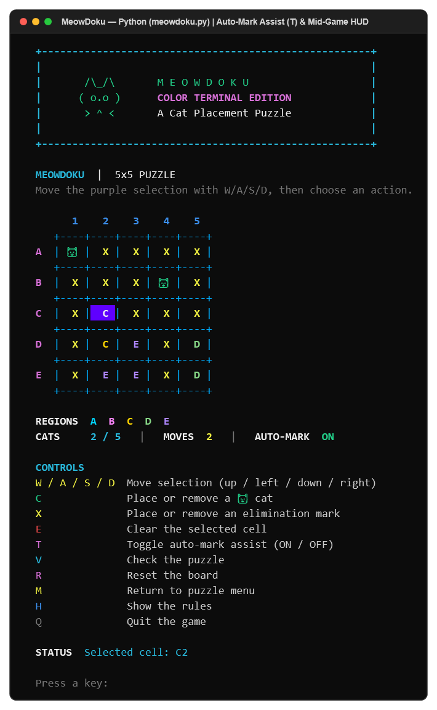
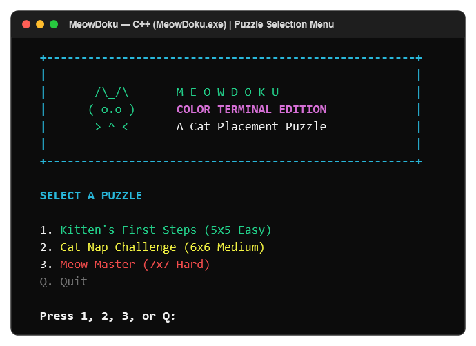
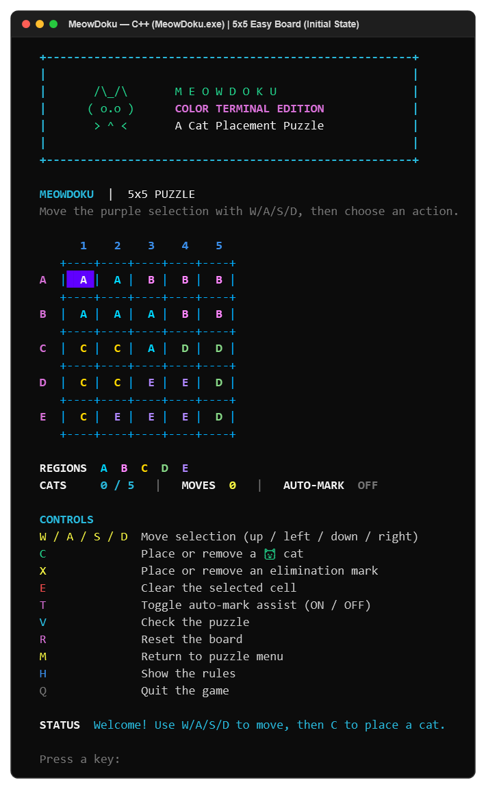
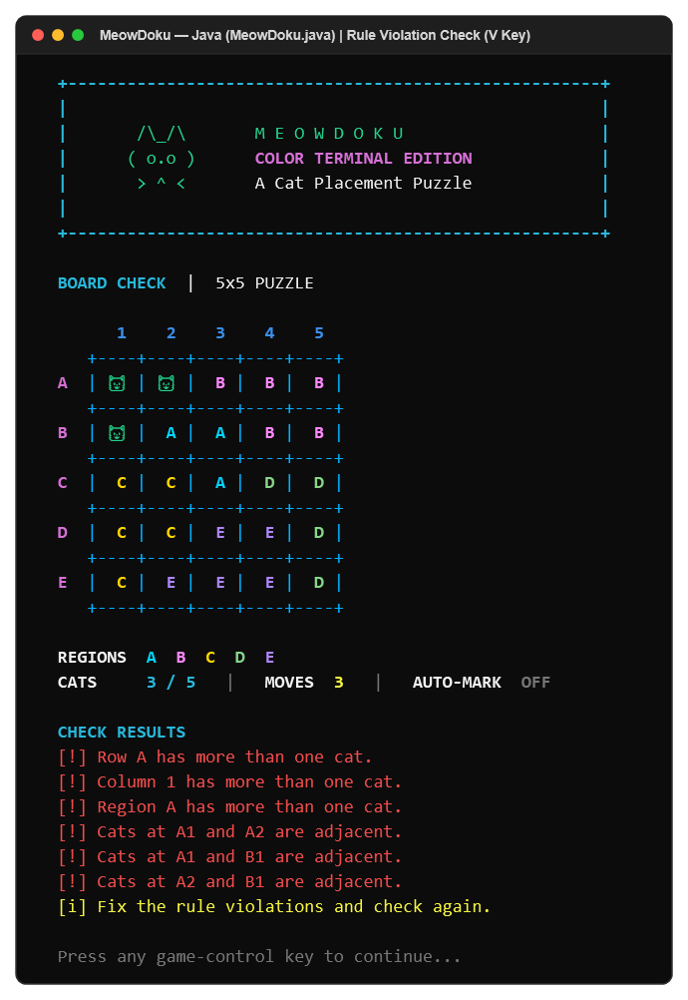
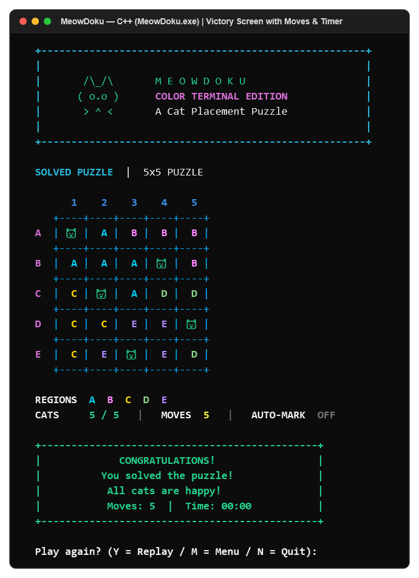
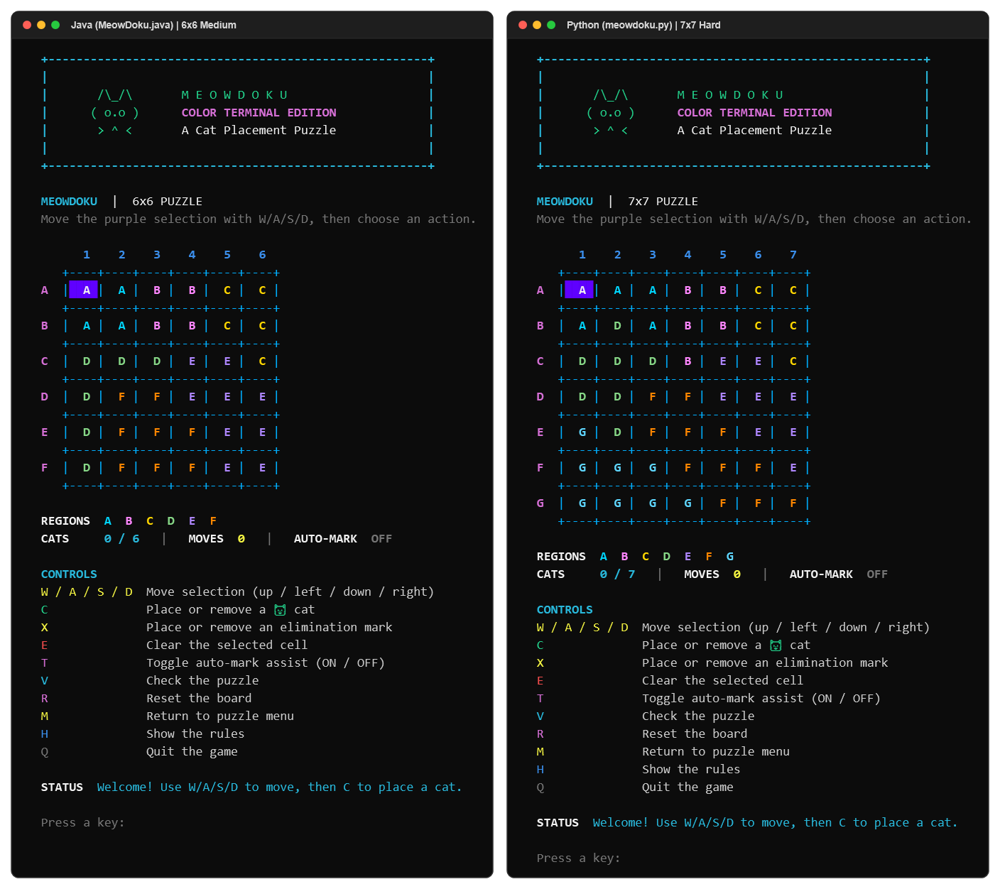
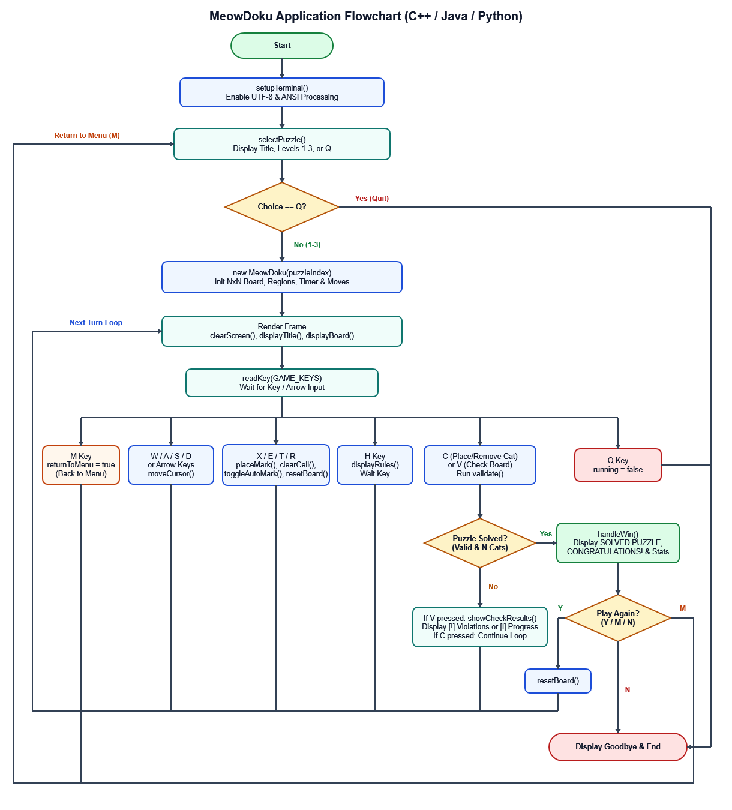

# MeowDoku — Color Terminal Edition

**A lightweight, territory-based cat placement logic puzzle implemented identically in C++, Java, and Python.**  
*CS208 – Programming Languages | Meowdoku Crew*

<p align="center">
  
</p>

---

## Overview

**MeowDoku** blends the row-and-column uniqueness of **Sudoku**, the territory partitioning of **Star Battle (Queens)**, and the spatial elimination mechanics of **Minesweeper** into a vibrant terminal puzzle game. Players navigate handcrafted territory grids and place exactly one cat (`🐱`) per row, column, and colored region while ensuring that no two cats touch horizontally, vertically, or diagonally.

Built with zero external dependencies across **C++17**, **Java**, and **Python 3**, all three implementations share identical board layouts, validation logic, ANSI 256-color rendering, keyboard controls, and cross-platform terminal handling.

### Key Features
- **Three-Language Parity:** Full functional and visual parity across `meowdoku.cpp`, `MeowDoku.java`, and `meowdoku.py`.
- **ANSI 256-Color Terminal UI & UTF-8 Emojis:** Distinct territory colors (`A`–`G`), green `🐱` cat icons, yellow `X` elimination marks, purple cursor highlight, and boxed ASCII cat banner.
- **Interactive Single-Key Navigation:** Smooth cursor movement with `W/A/S/D` or Arrow keys (`_getch` / `termios` / Windows `choice`), plus redirected-input fallback.
- **Live Telemetry HUD:** Real-time `CATS  x / N | MOVES | AUTO-MARK  ON/OFF` status bar and elapsed solve timer (`MM:SS`).
- **Auto-Mark Assist (`T`):** Optional helper mode that automatically places `X` elimination marks along the row, column, region, and 8 surrounding neighbors whenever a cat is placed.
- **Instant Validation & Diagnostics (`V`):** Detects victory automatically when all cats are placed validly, or lists exact `[!]` row, column, region, and adjacency violations.
- **Seamless Level Switching (`M`):** Return to the puzzle menu during gameplay or from the victory banner without restarting.

---

## How to Play

### Rules
1. Place exactly **one `🐱` cat** in each **row**.
2. Place exactly **one `🐱` cat** in each **column**.
3. Place exactly **one `🐱` cat** in each **color region** (`A`, `B`, `C`, ...).
4. **No two cats may touch**, horizontally, vertically, or diagonally.

### Controls

| Key | Action |
| :--- | :--- |
| `W` / `A` / `S` / `D` or `↑` / `←` / `↓` / `→` | Move purple cursor selection (up / left / down / right) |
| `C` | Place or remove a `🐱` cat at the selected cell |
| `X` | Place or remove an `X` elimination mark |
| `E` | Clear the selected cell |
| `T` | Toggle **Auto-Mark Assist** (`ON` / `OFF`) |
| `V` | Check the puzzle for rule violations or remaining cats |
| `R` | Reset the board, move counter, and timer |
| `M` | Return to the puzzle selection menu |
| `H` | Display the rules screen |
| `Q` | Quit the game |

---

## Puzzle Levels

| Level | Name | Grid Size | Regions | Sample Verified Solution |
| :---: | :--- | :---: | :---: | :--- |
| `1` | **Kitten's First Steps** (Easy) | `5 × 5` | `A`–`E` | `A1, B4, C2, D5, E3` |
| `2` | **Cat Nap Challenge** (Medium) | `6 × 6` | `A`–`F` | `A2, B4, C6, D1, E3, F5` |
| `3` | **Meow Master** (Hard) | `7 × 7` | `A`–`G` | `A1, B4, C7, D2, E6, F3, G5` |

---

## Getting Started

> **Tip:** Run inside a UTF-8 and ANSI-capable terminal such as **Windows Terminal**, **VS Code Integrated Terminal**, or a standard **Linux/macOS terminal** for full color and `🐱` emoji support.

### C++ (`meowdoku.cpp`)
**Windows (PowerShell / MinGW or MSYS2 g++):**
```powershell
g++ -std=c++17 -Wall -Wextra meowdoku.cpp -o MeowDoku.exe
.\MeowDoku.exe
```
*(A prebuilt Windows binary `MeowDoku.exe` and VS Code build task in `.vscode/tasks.json` are also included.)*

**Linux / macOS:**
```bash
g++ -std=c++17 -Wall -Wextra meowdoku.cpp -o MeowDoku
./MeowDoku
```

### Java (`MeowDoku.java`)
```bash
javac -encoding UTF-8 MeowDoku.java
java MeowDoku
```

### Python (`meowdoku.py`)
```bash
python meowdoku.py
```

---

## Screenshots & Architecture

### Game Screens

| Puzzle Selection | Initial 5×5 Board |
| :---: | :---: |
|  |  |

| Rule Violation Check (`V`) | Victory Screen with Solve Stats |
| :---: | :---: |
|  |  |

### Medium (6×6) & Hard (7×7) Boards
<p align="center">
  
</p>

### Application Flowchart
<p align="center">
  
</p>

---

## Project Structure

```text
MeowDoku/
├── .vscode/
│   └── tasks.json              # VS Code C++ build task configuration
├── docs/
│   └── screenshots/            # Captured terminal screenshots & flowchart PNGs
├── meowdoku.cpp                # C++17 source implementation
├── MeowDoku.exe                # Precompiled Windows executable
├── MeowDoku.java               # Java source implementation
├── meowdoku.py                 # Python 3 source implementation
└── README.md                   # Project overview & quick-start guide
```

---

## Credits

**Meowdoku Crew** — *CS208: Programming Languages*
- Sean Salvador
- Lloyd Hanz L. Lorenzo
